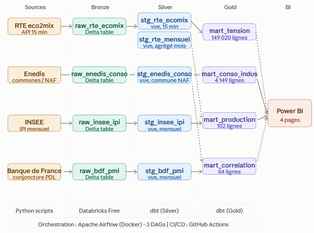
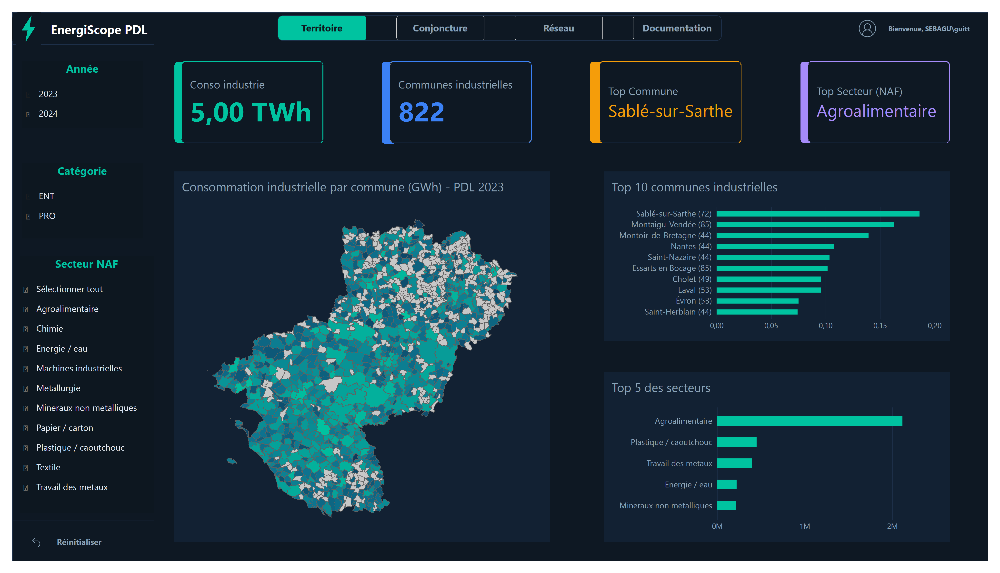
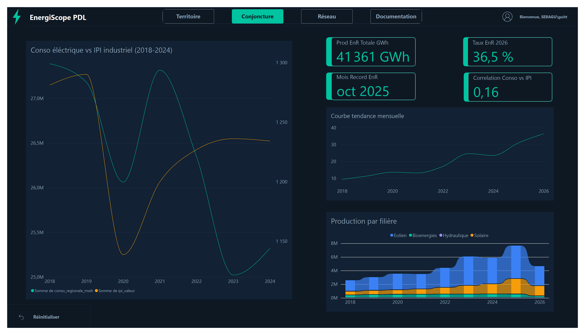
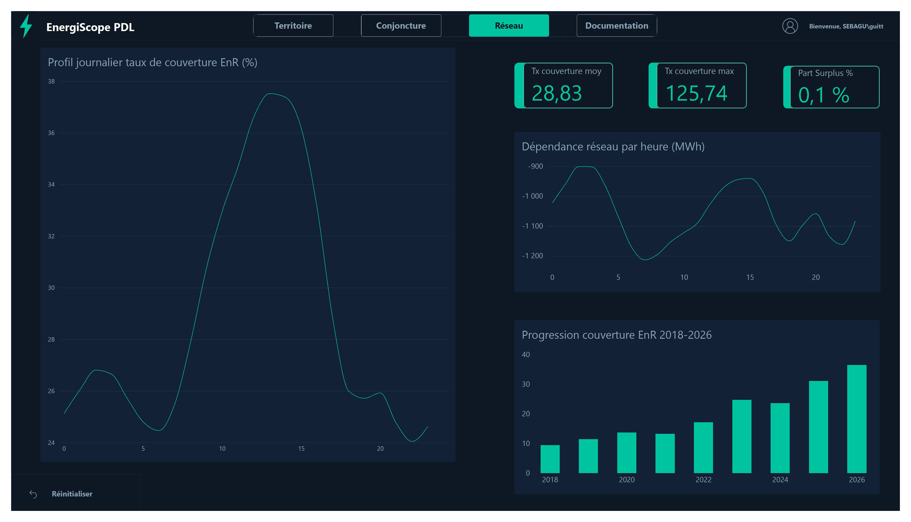
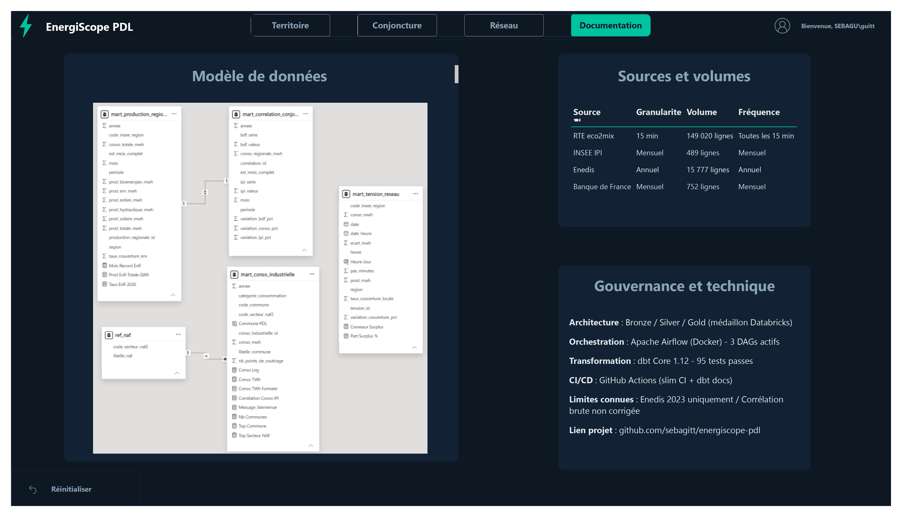

# EnergiScope PDL

Pipeline analytique de la consommation électrique industrielle en Pays de la Loire.

[](https://github.com/sebagitt/energiscope-pdl/actions/workflows/dbt_ci.yml)
[](https://github.com/sebagitt/energiscope-pdl/actions/workflows/dbt_docs.yml)
[](https://www.python.org/)
[](https://docs.getdbt.com/)
[](https://airflow.apache.org/)
[](https://www.databricks.com/)

> La consommation électrique des sites industriels (C1-C4) en PDL varie-t-elle avec les
> indicateurs conjoncturels sectoriels (PMI, IPI) — et peut-on anticiper des tensions réseau 24h avant ?

## Contexte

Les Pays de la Loire concentrent plusieurs acteurs industriels majeurs dont la consommation électrique représente plus de 5 TWh annuels. Dans un contexte de transition énergétique accélérée, comprendre la relation entre activité industrielle et équilibre du réseau électrique devient un enjeu opérationnel pour les gestionnaires de réseau et les décideurs territoriaux.

## Architecture

Le pipeline suit une architecture médaillon en trois couches, hébergée sur Databricks Free Edition avec Delta Lake comme format de stockage.



```
Sources API              Bronze (Delta)          Silver (dbt)               Gold (dbt)
RTE eco2mix (15 min) --> raw_rte_ecomix      --> stg_rte_ecomix        --> mart_tension_reseau
                     --> raw_rte_ecomix      --> stg_rte_mensuel       --> mart_production_regionale
Enedis communes      --> raw_enedis_conso    --> stg_enedis_conso      --> mart_conso_industrielle
INSEE IPI            --> raw_insee_ipi       --> stg_insee_ipi         --> mart_correlation_conjoncture
Banque de France     --> raw_bdf_pmi         --> stg_bdf_pmi
```

Les scripts d'ingestion Python appellent les APIs sources et chargent les données brutes en JSON dans des tables Delta. dbt prend en charge toutes les transformations depuis le nettoyage en staging jusqu'aux indicateurs métier en marts Gold. Un dashboard Power BI se connecte directement aux marts via JDBC Databricks.

## Stack technique

| Composant | Outil | Version |
|-----------|-------|---------|
| Cloud DWH | Databricks + Delta Lake | Free Edition |
| Transformation | dbt Core + dbt-databricks | 1.12 |
| Orchestration | Apache Airflow (Docker) | 2.9.3 |
| Conteneurisation | Docker Desktop + WSL2 | - |
| CI/CD | GitHub Actions | - |
| Dashboard | Power BI Desktop | - |
| Environnement | VSCode + Claude Code | - |

## Sources de données

| Source | Description | Granularité | Volume | Fréquence |
|--------|-------------|-------------|--------|-----------|
| RTE eco2mix (ODRE) | Production et consommation régionale PDL | 15 min | 149 000 lignes | Toutes les 15 min |
| Enedis Open Data | Consommation par commune et secteur NAF | Annuel | 15 777 lignes | Annuel |
| INSEE | Indice de production industrielle | Mensuel | 489 lignes | Mensuel |
| Banque de France | Conjoncture industrielle PDL (séries conj2-m-r52) | Mensuel | 752 lignes | Mensuel |

## Modèles dbt

Le projet compte 9 modèles et 100 tests automatisés.

**Staging (Silver)** : un modèle par source, matérialisé en vues Databricks. Chaque modèle gère le nettoyage, le cast des types, la déduplication et la génération de clés surrogates via dbt_utils. Aucune jointure cross-sources à ce niveau.

**Marts (Gold)** :

| Modèle | Grain | Lignes | Description |
|--------|-------|--------|-------------|
| mart_conso_industrielle | année x commune x secteur NAF | 4 149 | Consommation industrielle PDL par commune (5,15 TWh en 2023) |
| mart_production_regionale | année x mois x région | 102 | Production par filière EnR (éolien, solaire, hydraulique, bioénergies) |
| mart_correlation_conjoncture | année x mois | 84 | Corrélation consommation / IPI / conjoncture BdF (2018-2024) |
| mart_tension_reseau | date_heure x région | 149 020 | Taux de couverture locale et écart production-consommation (15 min) |

La documentation dbt est publiée sur GitHub Pages via GitHub Actions.

## Orchestration

Trois DAGs Airflow tournent dans une image Docker personnalisée embarquant les environnements Python ingestion et dbt :

| DAG | Schedule | Description |
|-----|----------|-------------|
| energiscope_rte_realtime | Toutes les 15 min | Ingestion RTE sur une fenêtre glissante de 2 heures |
| energiscope_ingestion_daily | 6h00 chaque matin | Ingestion Enedis, INSEE et Banque de France |
| energiscope_dbt | 7h00 chaque matin | dbt run + dbt test sur staging et marts |

## CI/CD

| Workflow | Déclencheur | Description |
|----------|-------------|-------------|
| dbt_ci.yml | Push et PR sur main et develop | Compilation + slim CI (state:modified+) avec manifest de référence |
| dbt_docs.yml | Push sur main | Génération et déploiement dbt docs sur GitHub Pages |

La CI isole ses runs dans des schémas ci_silver et ci_gold pour éviter tout impact sur les données de production.

## Dashboard Power BI

Quatre pages connectées aux marts Gold via JDBC Databricks (mode Import).

**Territoire** : carte choroplèthe des communes PDL par consommation industrielle (Shape Map + GeoJSON IGN), Top 10 communes, répartition par secteur NAF.



**Conjoncture** : courbe double axe consommation vs IPI (2018-2024), évolution de la production EnR par filière, indicateurs de couverture et corrélation.



**Réseau** : profil journalier du taux de couverture EnR sur 24 heures (pic solaire visible à 14h), dépendance réseau par heure, progression annuelle 2018-2026.



**Documentation** : modèle de données, sources et volumes, gouvernance et liens techniques.



Note : les filtres Catégorie et Secteur NAF sont actifs uniquement sur la page Territoire. Les pages Conjoncture et Réseau s'appuient sur des agrégats régionaux RTE sans décomposition sectorielle.

## Résultats et impact

- La région PDL couvre en moyenne 28,8 % de sa consommation électrique depuis des sources renouvelables, avec des pics ponctuels dépassant 125 % sur certains créneaux solaires.
- La couverture progresse de 10 % en 2018 à 38 % en 2026, portée principalement par l'éolien (65 % de la production EnR) et un solaire en forte croissance depuis 2022.
- Sablé-sur-Sarthe, Montaigu-Vendée et Montoir-de-Bretagne concentrent les consommations industrielles les plus élevées de la région.
- Le secteur agroalimentaire représente 35 % de la consommation industrielle régionale.
- La corrélation brute entre consommation régionale et IPI industriel ressort à 0,16. Ce signal faible s'explique par la domination de la saisonnalité thermique sur la consommation électrique régionale.

## Limites documentées

- Les données Enedis couvrent uniquement 2023. Charger les années antérieures permettrait une analyse temporelle de la consommation industrielle par commune.
- La corrélation consommation / IPI nécessite une correction de la saisonnalité thermique pour isoler le signal industriel.
- Les données INSEE et Banque de France s'arrêtent en 2024, limitant mart_correlation_conjoncture à la période 2018-2024.
- L'actualisation planifiée du dashboard Power BI nécessite Power BI Service, non couvert dans ce projet.
- Les filtres Power BI sont limités à la page Territoire : RTE ne publie pas de données par secteur NAF ou par commune.

## Débogage et problèmes connus

**Secrets mal formatés dans GitHub Actions**
Symptôme : `host='databricks_host=dbc-...'` dans les logs, connexion refusée après 15 minutes.
Cause : le .env contient `NOM=valeur` et le secret GitHub a été renseigné avec le préfixe `NOM=` inclus.
Solution : ne coller que la valeur brute dans les secrets GitHub, sans le nom de variable.

**Mismatch catalog Databricks**
Symptôme : `TABLE_OR_VIEW_NOT_FOUND` sur `main.bronze.raw_*` alors que les tables sont dans `workspace.bronze`.
Cause : `catalog: main` dans profiles.yml au lieu de `catalog: workspace`.
Solution : vérifier le catalog réel dans l'URL du workspace Databricks et l'aligner dans profiles.yml.

**Venv ingestion non activé**
Symptôme : `ModuleNotFoundError: No module named 'tenacity'`.
Cause : le venv racine (dbt) est activé au lieu de `ingestion/.venv`.
Solution : utiliser `scripts/activate_env.ps1 ingestion` avant toute commande Python d'ingestion.

## Prochaines étapes

- Charger les millésimes Enedis 2018-2022 pour une analyse temporelle de la consommation par commune.
- Étendre les séries INSEE et Banque de France au-delà de 2024 dès publication.
- Appliquer une correction saisonnière thermique sur mart_correlation_conjoncture.
- Publier le dashboard sur Power BI Service pour activer l'actualisation planifiée automatique.
- Ajouter les données de prix spot électricité (EPEX) pour enrichir l'analyse de tension réseau.

## Structure du projet

```
energiscope-pdl/
├── ingestion/              scripts Python d'ingestion API (4 sources)
│   ├── src/               rte_ecomix.py, enedis_conso.py, insee_ipi.py, bdf_pmi.py
│   └── tests/             97 tests pytest
├── airflow/                configuration Airflow Docker
│   ├── Dockerfile         image custom avec venvs ingestion et dbt
│   ├── docker-compose.yml
│   └── dags/              3 DAGs + module commun
├── dbt/                    projet dbt
│   ├── models/
│   │   ├── staging/       5 modèles Silver
│   │   └── marts/         4 modèles Gold
│   ├── macros/
│   └── tests/
├── powerbi/                dashboard .pbix (non versionné)
│   └── screenshots/       captures des 4 pages
├── docs/                   architecture et lineage dbt
├── scripts/                activate_env.ps1, check_secrets.sh
└── .github/workflows/      dbt_ci.yml, dbt_docs.yml
```

## Lancer le projet

```powershell
# Copier le template de variables d'environnement
cp .env.example .env
# Renseigner DATABRICKS_HOST, DATABRICKS_TOKEN, DATABRICKS_HTTP_PATH,
# BDF_API_KEY et AIRFLOW_FERNET_KEY

# Tester la connexion Databricks
. .\scripts\activate_env.ps1 dbt
cd dbt && dbt debug

# Démarrer Airflow
cd ..\airflow && docker compose up -d

# Ingestion manuelle RTE
. .\scripts\activate_env.ps1 ingestion
cd ingestion && python src/rte_ecomix.py --date 2026-10-01

# Pipeline dbt complet
. .\scripts\activate_env.ps1 dbt
cd dbt && dbt run && dbt test
```
